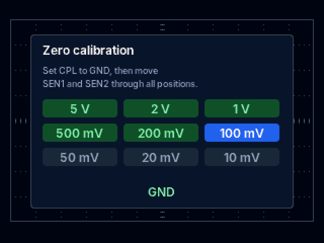

# DSO138 Open – Firmware

New open source firmware for the **JYE Tech DSO138** pocket oscilloscope
(STM32F103C8, 2.4" 320×240 ILI9341 TFT, kits 13803K/13804K, main board 109-13800-00C).
Written from scratch and MIT licensed.


| | |
| --- | --- |
|  |  |
|  |  |

## Features

- Timebases from 10 µs/div to 10 s/div. 50 µs/div and slower use timer driven
  sampling at exactly 25 samples per division. 10 and 20 µs/div use both ADCs
  interleaved at about 1.7 MS/s.
- Roll mode in Auto from 100 ms/div up.
- Trigger: Auto, Normal and Single, rising or falling edge, adjustable level
  with hysteresis and adjustable trigger position (pre-trigger up to half the
  1024-sample frame). When stopped, the position control scrolls through the
  captured frame.
- Automatic measurements: frequency, Vpp, Vrms and duty cycle; clipping warning.
- Status bar with timebase, V/div, coupling and trigger settings; markers for
  ground level, trigger level and trigger position.
- Zero calibration for all nine input ranges, stored in flash.
- Settings stored in the last flash page with wear levelling.
- Serial interface on J5 (115200 8N1) with waveform export.
- Anti-aliased Inter fonts and a Tailwind/Preline slate palette; trace color
  selectable in the settings (white, yellow, cyan, green, orange, pink).
- Updates from the browser without jumpers, calibration and settings are kept.
- Languages: English (US), English (UK), German, Spanish, French.

## Controls

| Button | Short press | Long press |
| --- | --- | --- |
| **SEL** | Next parameter: timebase → trigger mode → edge → level → vertical position → trigger position | Reset the selected parameter |
| **– / +** | Change the selected parameter (hold to repeat, accelerates) | |
| **OK** | Run / Stop (re-arms in Single mode) | Settings menu |

The **SEN1**, **SEN2** and **CPL** slide switches work as before; the firmware
reads their positions and shows them in the status bar.

In the settings menu, **– / +** move the selection, **OK** changes or opens an
entry and **SEL** closes the menu.

## Flashing

The mini USB socket of the DSO138 has no function (JYE: "provided for future or
user own use"), and the STM32F103 ROM bootloader cannot flash over USB anyway.
Flashing goes through the STM32 serial bootloader on header **J5** with a
3.3 V USB-TTL adapter.

1. Connect the adapter to J5: GND to GND, adapter TX to RXD, adapter RX to TXD.
   Leave the adapter's 5 V unconnected and power the DSO138 as usual.
2. **First flash only** (or when coming from the stock firmware): close the
   jumpers **JP1** and **JP2** (boot mode) and power on.
3. Open the browser flasher (Chrome, Edge or Opera on a desktop):
   <https://sickdaflip.github.io/dso0138/>, choose the firmware and click
   **Flash**.
4. If you closed JP1/JP2, open them again before the next power up.

From 0.2.0 on, the flasher asks a running DSO138 Open to jump into the STM32
bootloader by itself (serial command `boot`), so updates need neither jumpers
nor a power cycle. Updates only erase the pages the firmware occupies, so
calibration and settings in the last flash page survive (option *Keep
calibration and settings*).

The flasher removes the read protection of the stock firmware automatically
(this mass erases the chip). It can also restore the original JYE firmware and
back up an unprotected chip.

Alternatives: `pio run -t upload` with the adapter port, or
`stm32flash -w dso138-open-x.y.z.bin -v -g 0x0 /dev/ttyUSB0`.

### Restoring the original firmware

`original-firmware/113-13801-061.hex` is the stock JYE Tech firmware
(FW 113-13801-061). Select **Original JYE firmware** in the flasher to go back.
This file is copyright JYE Tech and not covered by the MIT license of this project.

## First steps after flashing

1. Hold **OK** → **Zero calibration**. Set CPL to GND and move SEN1 and SEN2
   through all positions until all nine ranges are green.
2. Connect the probe to the test signal (1 kHz, 3.3 V square wave), set SEN1 to
   0.1V, SEN2 to ×5 (giving 0.5 V/div) and the timebase to 0.2 ms/div. Adjust the
   trimmer C4 for flat tops (probe compensation).

## Live view

With the jumpers open, connect the same adapter and click **Connect** in the
live view section of the flasher page. The waveform is streamed every 0.5 s and
can be exported as CSV.

Serial commands (115200 8N1, line based):

| Command | Response |
| --- | --- |
| `i` | Firmware name and version |
| `w` | `#frame dt=… n=… trig=… zero=… vpc=… vdiv=… tdiv=… cpl=… roll=… col=…`, raw ADC counts (32 per line), `#end` |
| `m` | `#meas freq=… vpp=… vrms=… vavg=… vmax=… vmin=… duty=…` |
| `s1` / `s0` | Stream frames on / off |
| `boot` | `#boot`, then jump to the STM32 serial bootloader (115200 8E1) |

Volts = (count − zero) × vpc. Time of sample *i* = (i − trig) × dt.

## Building

```sh
pio run                     # firmware: .pio/build/dso138/firmware.bin
tools/sim/render.sh         # UI previews: docs/images/*.png (language index as argument)
python3 -I tools/gen_fonts.py   # regenerate fonts.h / colors.h (needs Pillow + Inter)
cd web && npm ci && npm run build && npm test   # flasher site and bootloader self-test
```

## Hardware notes

| Function | Pin |
| --- | --- |
| TFT data D0–D7 | PB0–PB7 (JTAG disabled, SWD kept) |
| TFT RD / RST / CS / RS / WR | PB10 / PB11 / PC13 / PC14 / PC15 |
| Signal input | PA0 (ADC) |
| SEN2 / SEN1 / CPL switch sensing | PA1 / PA2 / PA3 (ADC2) |
| Test signal 1 kHz | PA7 (TIM3 CH2) |
| Trigger reference | PB8 (TIM4 CH3) |
| Negative rail charge pump | PB9 (TIM4 CH4, 20 kHz) – started first at boot |
| Buttons SEL / – / + / OK | PB12 / PB13 / PB14 / PB15 |
| LED | PA15 |
| Serial | PA9 TX / PA10 RX on J5 |

One division is about 100 ADC counts on every range; the switch dividers
select the range. Settings live in flash page 63 (0x0800FC00).

## Status

1.0.0, tested on a 109-13800-00C board: display, timer modes, trigger,
measurements, zero calibration, flasher (including jumper-free updates) and
live view work. The interleaved 10/20 µs/div
mode and roll mode still need more real-world testing.

## License

MIT, see [LICENSE](LICENSE). Fonts derived from Inter (SIL Open Font License 1.1).
Not affiliated with JYE Tech.
