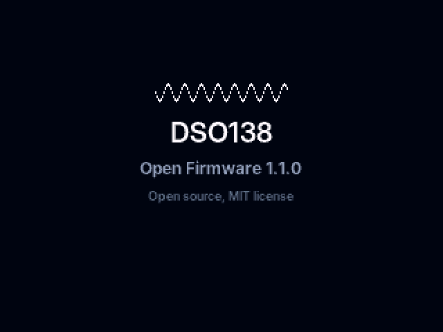
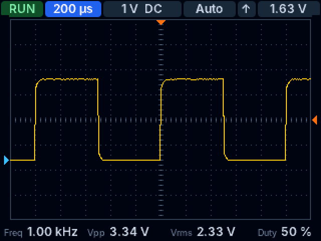
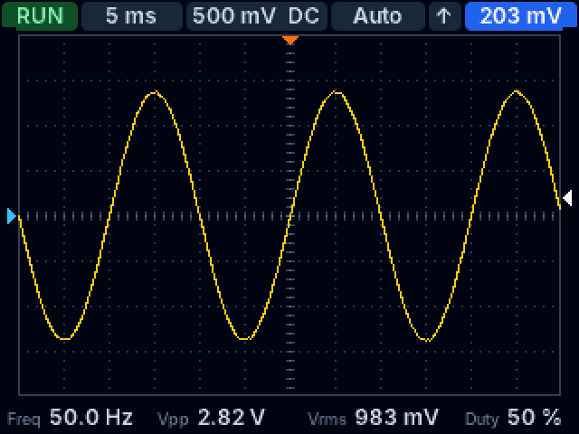
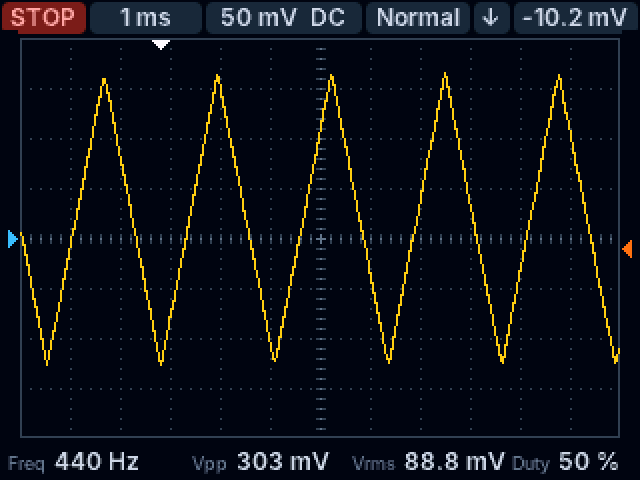
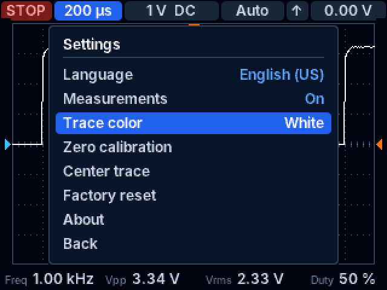
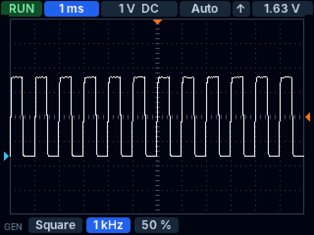

# DSO138 Open – Firmware

New open source firmware for the **JYE Tech DSO138** pocket oscilloscope
(STM32F103C8, 2.4" 320×240 ILI9341 TFT, kits 13803K/13804K, main board 109-13800-00C).
Written from scratch and MIT licensed.

 

| | |
| --- | --- |
|  |  |
|  |  |
|  |  |

## Features

- Timebases from 10 µs/div to 10 s/div. 50 µs/div and slower use timer driven
  sampling at exactly 25 samples per division. 10 and 20 µs/div use both ADCs
  interleaved at about 1.7 MS/s.
- Roll mode in Auto from 100 ms/div up.
- Trigger: Auto, Normal and Single, rising or falling edge, adjustable level
  with hysteresis, holdoff (10 µs – 1 s: the signal must stay on the far
  side of the level that long before an edge counts, so bursts and serial
  frames trigger on their first edge) and adjustable trigger position (pre-trigger up to half the
  1024-sample frame). When stopped, the position control scrolls through the
  captured frame.
- Automatic measurements: frequency, Vpp, Vrms and duty cycle; clipping warning.
- Status bar with timebase, V/div, coupling and trigger settings; markers for
  ground level, trigger level and trigger position.
- Zero calibration for all nine input ranges, stored in flash.
- Settings stored in the last flash page with wear levelling.
- Serial interface on J5 (115200 8N1) with waveform export.
- Anti-aliased Inter fonts and a Tailwind/Preline slate palette; trace color
  selectable in the settings (white, yellow, cyan, green, orange, pink).
- Updates from the browser without jumpers, calibration and settings are kept.
- Signal generator on the test signal pin (0/3.3 V, software only, no extra
  parts), see below.
- Languages: English (US), English (UK), German, Spanish, French.

## Controls

| Button | Short press | Long press |
| --- | --- | --- |
| **SEL** | Next parameter: timebase → trigger mode → edge → level → holdoff → vertical position → trigger position | Reset the selected parameter |
| **– / +** | Change the selected parameter (hold to repeat, accelerates) | |
| **OK** | Run / Stop (re-arms in Single mode) | Settings menu |

The **SEN1**, **SEN2** and **CPL** slide switches work as before; the firmware
reads their positions and shows them in the status bar.

In the settings menu, **– / +** move the selection, **OK** changes or opens an
entry and **SEL** closes the menu.

## Signal generator

Hold **OK** → **Signal generator**. The scope keeps running while the bottom
bar shows the generator: **SEL** selects mode or parameter, **– / +** change
it, **OK** returns to the measurements. The output is the test signal pin
(red clip), so the scope can measure its own signals.

| Mode | Parameters | Use |
| --- | --- | --- |
| Test 1 kHz | – | Stock calibration signal (default after power-up) |
| Square | 1 Hz – 1 MHz (1-2-5), duty 5 – 95 % | Timebases, frequency and duty measurement |
| Sweep | 2 / 5 / 10 / 20 s | Square sweeping 100 Hz → 100 kHz logarithmically |
| Burst | 1 – 100 kHz, 1 – 20 pulses | Pulse trains with pauses, Normal/Single trigger |
| Glitch | 1 – 100 µs | 1 kHz square with a short extra pulse every 10th period |
| UART | 1200 – 115200 Bd | "Hello DSO138!\r\n", 8N1, repeated every 20 ms |
| PRBS | 100 bit/s – 50 kbit/s | PRBS7 random bit pattern |
| Servo | 0.5 – 2.5 ms | 50 Hz RC servo pulses |
| IR remote | command 0x00 – 0xFF | NEC frame as an IR receiver outputs it (active low) |
| Fan PWM | 0 – 100 % | 25 kHz 4-pin fan PWM |

Continuous modes are hardware PWM (TIM3). Patterned modes are played by the
TIM3 update interrupt, one segment per timer period, computed on the fly.

## Flashing

The mini USB socket of the DSO138 has no function (JYE: "provided for future or
user own use"), and the STM32F103 ROM bootloader cannot flash over USB anyway.
Flashing goes through the STM32 serial bootloader on header **J5** with a
3.3 V USB-TTL adapter.

1. Connect the adapter to J5: GND to GND, adapter TX to RXD, adapter RX to TXD.
   Leave the adapter's 5 V unconnected and power the DSO138 as usual.
2. **First flash only** (or when coming from the stock firmware): close the
   jumpers **JP1** and **JP2** (boot mode) and power on.
3. Open the browser flasher (Chrome, Edge or Opera on a desktop):
   <https://sickdaflip.github.io/dso0138/>, choose the firmware and click
   **Flash**.
4. If you closed JP1/JP2, open them again before the next power up.

From 0.2.0 on, the flasher asks a running DSO138 Open to jump into the STM32
bootloader by itself (serial command `boot`), so updates need neither jumpers
nor a power cycle. Updates only erase the pages the firmware occupies, so
calibration and settings in the last flash page survive (option *Keep
calibration and settings*).

The flasher removes the read protection of the stock firmware automatically
(this mass erases the chip). It can also restore the original JYE firmware and
back up an unprotected chip.

Alternatives: `pio run -t upload` with the adapter port, or
`stm32flash -w dso138-open-x.y.z.bin -v -g 0x0 /dev/ttyUSB0`.

### Restoring the original firmware

`original-firmware/113-13801-061.hex` is the stock JYE Tech firmware
(FW 113-13801-061). Select **Original JYE firmware** in the flasher to go back.
This file is copyright JYE Tech and not covered by the MIT license of this project.

## First steps after flashing

1. Hold **OK** → **Zero calibration**. Set CPL to GND and move SEN1 and SEN2
   through all positions until all nine ranges are green.
2. Connect the probe to the test signal (1 kHz, 3.3 V square wave), set SEN1 to
   0.1V, SEN2 to ×5 (giving 0.5 V/div) and the timebase to 0.2 ms/div. Adjust the
   trimmer C4 for flat tops (probe compensation).

## Live view and remote control

With the jumpers open, connect the same adapter and click **Connect** in the
live view section of the flasher page. The waveform is streamed every 0.5 s and
can be exported as CSV (see *Recording* below for longer recordings). The remote control section below then operates every
setting of the DSO138: run/stop, timebase, trigger mode, edge and level,
positions, measurements, trace color, device language and the signal
generator. V/div and coupling are set by the slide switches and are shown.

### Recording

The live view can record the signal over minutes into a single CSV file.

1. On the device, set the trigger to **Auto** and the timebase to
   **100 ms/div or slower**, so the status bar shows **ROLL**.
2. In the live view, click **Record**. Streaming starts by itself; the status
   next to the button shows duration, number of values and the mode, e.g.
   `02:15 · 33,750 values · gap-free (roll)`.
3. Click **Stop recording**, then **Save recording (CSV)**.

The file has the columns `time_s, volts, segment`: the whole recording in one
piece with a continuous time axis.

| Timebase | Samples per second | Useful for signals up to about |
| --- | --- | --- |
| 100 ms/div | 250 | 25 Hz |
| 200 ms/div | 125 | 12 Hz |
| 1 s/div | 25 | 2 Hz |
| 10 s/div | 2.5 | 0.2 Hz |

Good for voltage curves, temperatures, charging voltage or slow sensor
signals. The serial line carries about 2000 samples per second, so gap-free
recording is limited to roll mode. With faster timebases the recording still
works, but frame by frame with gaps in between; each frame becomes its own
segment.

Roll frames carry the running index of their first sample (`pos=`). If a
frame gets lost on the line, the time axis stays exact and the gap starts a
new segment.

**Capture** is different: it keeps the frame currently shown for a quick CSV
export of that single screen while the live view keeps running.

Serial commands (115200 8N1, line based):

| Command | Response |
| --- | --- |
| `i` | Firmware name and version |
| `w` | `#frame dt=… n=… append=… trig=… zero=… vpc=… vdiv=… tdiv=… cpl=… roll=… col=…`, raw ADC counts (32 per line), `#end n=… sum=…` (sample count and 16-bit sum; the web view drops frames that arrive damaged) |
| `m` | `#meas freq=… vpp=… vrms=… vavg=… vmax=… vmin=… duty=…` |
| `s1` / `s0` | Stream frames on / off |
| `boot` | `#boot`, then restart into the STM32 serial bootloader (115200 8E1) |
| `state` | `#state tb=… mode=… edge=… level=… holdoff=… vpos=… hpos=… run=… meas=… color=… lang=… range=… cpl=… gen=… gn=… gp0=… gp1=… gs0=… gs1=… vpc=…`, then `#gd0 <text>` / `#gd1 <text>` with the generator parameters |
| `set <key> <n>` | Sets `tb`, `mode`, `edge`, `level`, `holdoff`, `vpos`, `hpos`, `meas`, `color` or `lang` (values as in `#state`), answers `#state` |
| `run 0` / `run 1` | Stop / run |
| `center` | Trace and trigger back to the center |
| `gen <mode>` / `genp <which> <step>` | Generator mode (0–9) / parameter step |

The device also sends `#state` whenever something changes on it (buttons,
slide switches, a finished single shot), so the web interface stays in sync.

Volts = (count − zero) × vpc. Time of sample *i* = (i − trig) × dt. While
streaming in roll mode, frames come every 100 ms with `append=1` and only the
new samples; append them to the previous ones (one screen is 300 samples).

## Logo

The boot and bootloader screens show the FlipDev logo from
`assets/flipdev.svg`, converted by `tools/gen_logo.py` into a 4-bit alpha mask
with run-length encoding (`src/logo.h`, about 3.5 KB) and drawn in white.

## Building

```sh
pio run                     # firmware: .pio/build/dso138/firmware.bin
tools/sim/render.sh         # UI previews: docs/images/*.png (language index as argument)
python3 -I tools/gen_fonts.py   # regenerate fonts.h / colors.h (needs Pillow + Inter)
cd web && npm ci && npm run build && npm test   # flasher site and bootloader self-test
```

## Hardware notes

| Function | Pin |
| --- | --- |
| TFT data D0–D7 | PB0–PB7 (JTAG disabled, SWD kept) |
| TFT RD / RST / CS / RS / WR | PB10 / PB11 / PC13 / PC14 / PC15 |
| Signal input | PA0 (ADC) |
| SEN2 / SEN1 / CPL switch sensing | PA1 / PA2 / PA3 (ADC2) |
| Test signal / signal generator | PA7 (TIM3 CH2) |
| Trigger reference | PB8 (TIM4 CH3) |
| Negative rail charge pump | PB9 (TIM4 CH4, 20 kHz) – started first at boot |
| Buttons SEL / – / + / OK | PB12 / PB13 / PB14 / PB15 |
| LED | PA15 |
| Serial | PA9 TX / PA10 RX on J5 |

One division is about 100 ADC counts on every range; the switch dividers
select the range. Settings live in flash page 63 (0x0800FC00).

## Status

Tested on a 109-13800-00C board with the built-in signal generator and the
live view CSV export:

| Test | Result |
| --- | --- |
| Square 100 kHz at 10 µs/div (interleaved ADCs) | 100.009 kHz, period 9.96 – 10.05 µs, duty 50.2 % |
| UART 9600 Bd at 1 ms/div, Normal, falling edge | "Hello DSO138!\r\n" decoded without errors, frame 15.50 ms (15.52 ms expected) |
| Burst 5 kHz × 6, Single, holdoff 1 ms | always triggers on the first pulse, burst spacing 4.8 ms |
| Glitch 20 µs at 500 µs/div | one glitch every 10 ms, centered in the low phase |
| Test signal 1 kHz at 1 V/div after zero calibration | 1.00 kHz, 3.28 Vpp, 50 % |
| Roll mode 200 ms/div | smooth on the display and in the live view |
| Flasher, jumper-free updates, remote control both ways | working |

## License

MIT, see [LICENSE](LICENSE). Fonts derived from Inter (SIL Open Font License 1.1).
Not affiliated with JYE Tech.
